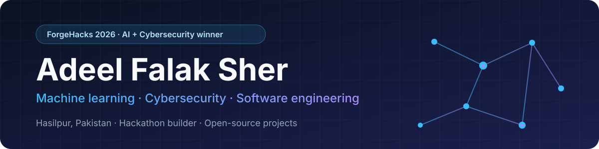

  

  <a href="https://adeelfalaksher.cv/"><b>Portfolio</b></a> &nbsp;·&nbsp;
  <a href="https://github.com/adeelfalaksher900-creator?tab=repositories&amp;type=source"><b>Original repositories</b></a> &nbsp;·&nbsp;
  <a href="#projects"><b>Projects</b></a> &nbsp;·&nbsp;
  <a href="#recognition"><b>Recognition</b></a> &nbsp;·&nbsp;
  <a href="#education"><b>Education</b></a> &nbsp;·&nbsp;
  <a href="#contact"><b>Contact</b></a>

  
  
  
  
  
  
  
  
  

---

## About

I'm an early-career builder from **Hasilpur, Pakistan**. Since finishing my Higher Secondary Certificate in 2025, I've focused on three areas: **machine learning**, **cybersecurity** and **software engineering**. Many of my projects began as hackathon builds, and I keep them public with their code, tests and stated limits.

- **Evidence over claims.** Projects link to source code, tests and live demos where they exist.
- **Honest scope.** Prototypes, simulated data and unfinished work are labeled as such.
- **Clear explanations.** Project READMEs describe how each system works and where it stops.

## Focus areas

| Area | What I build | Where to look |
| :--- | :--- | :--- |
| **Machine learning** | Text classification with held-out evaluation, JavaScript and Python parity checks, speech-signal analysis | [SecondLook](https://github.com/adeelfalaksher900-creator/secondlook-forgehacks) · [CadenceLab](https://github.com/adeelfalaksher900-creator/cadencelab-mah2026) |
| **Cybersecurity** | Explainable threat cues, XSS and IDOR protections, URL-scheme validation, authenticated encryption | [SecondLook](https://github.com/adeelfalaksher900-creator/secondlook-forgehacks) · [EVENTOS](https://github.com/adeelfalaksher900-creator/smart-event-management-platform) · [Relay Ledger](https://github.com/adeelfalaksher900-creator/relay-ledger-offgrid) |
| **Software engineering** | Automated tests and CI, command-line tools with defined exit codes, deterministic logic, offline-first design | [Rowglass](https://github.com/adeelfalaksher900-creator/rowglass) · [MCP Rehearsal](https://github.com/adeelfalaksher900-creator/mcp-rehearsal) · [RelayPlan](https://github.com/adeelfalaksher900-creator/relayplan) |
| **Front-end and accessibility** | React and TypeScript interfaces, responsive layouts, keyboard navigation, reduced-motion support | [RelayPlan](https://github.com/adeelfalaksher900-creator/relayplan) · [EVENTOS](https://github.com/adeelfalaksher900-creator/smart-event-management-platform) |

## Projects

### Hackathon and open-source projects

| Project | Built for | What it does | License |
| :--- | :--- | :--- | :---: |
| **[SecondLook](https://github.com/adeelfalaksher900-creator/secondlook-forgehacks)** [Live](https://secondlook-forgehacks.vercel.app/) · [Demo](https://secondlook-forgehacks.vercel.app/demo.html) | 🏆 ForgeHacks Online 2026, AI + Cybersecurity track winner | Helps readers pause before acting on suspicious messages. A TF-IDF and logistic-regression model runs in the browser and shows which cues drove its score. It reaches 97.17% spam precision on a held-out SMS test set and never labels a message "safe". |  |
| **[Relay Ledger](https://github.com/adeelfalaksher900-creator/relay-ledger-offgrid)** [Live](https://relay-ledger-offgrid.vercel.app/) | HACK47: OFFGRID, 2026 | An offline-first handoff board for volunteer crews. Edits made without a network merge without silent overwrites, and conflicting values stay visible until someone resolves them. Handoffs use AES-256-GCM with PBKDF2 (600,000 iterations) and can travel as a file or a QR stream. |  |
| **[RelayPlan](https://github.com/adeelfalaksher900-creator/relayplan)** [Live](https://relayplan-eurekadev.vercel.app/) · [Walkthrough](https://relayplan-eurekadev.vercel.app/demo.html) | EurekaDev 2026, Coding track (team project with Raouf Khalid) | A relief-allocation simulator for planning exercises. It maximizes the lowest community coverage first, then total deliveries and transport effort, and compares against a simple baseline. Synthetic data only, with route-closure stress tests. |  |
| **[CadenceLab](https://github.com/adeelfalaksher900-creator/cadencelab-mah2026)** [Live](https://cadencelab-mah2026.vercel.app/) · [Devpost](https://devpost.com/software/cadencelab) | Multimodal AI Hackathon 2026, Track C | A speech-delivery evidence workbench. It compares two recordings of one transcript using a quantized Wav2Vec2 model, CTC forced alignment and signal processing, then lets a coach listen to the measured regions. Runs in the browser with no account. |  |
| **[Rowglass](https://github.com/adeelfalaksher900-creator/rowglass)** | Nebius × NVIDIA Global AI Hackathon, Coding and Agentic Engineering track | Finds SQL queries that run successfully but silently drop rows or inflate totals. It compares a query with an independent reference on small synthetic databases, reduces a disagreement to a one-row example, and tests proposed fixes. Node.js, SQLite, a CLI and CI. Hackathon build; live model calls are not yet verified. |  |
| **[MCP Rehearsal](https://github.com/adeelfalaksher900-creator/mcp-rehearsal)** | 2026 Amazon Developer Hackathon | Tests approval and recovery behavior for MCP workflows, such as duplicate requests, stale context, service rejections and undo, in disposable fixtures before a real person is involved. Includes a read-only probe for MCP 2025-11-25 initialization and tool discovery. |  |
| **[EVENTOS](https://github.com/adeelfalaksher900-creator/smart-event-management-platform)** | Prompt Wars 2026 | An event-lifecycle platform prototype with QR check-in, deterministic team matchmaking, role-gated announcements, judging with assignment checks, and a leaderboard derived from judging scores. React, TypeScript, Vite and Tailwind CSS. Simulated data, clearly labeled. | — |

### Learning and community projects

| Project | What it does | Links |
| :--- | :--- | :--- |
| **SATOpen** | Free Digital SAT preparation: lessons, practice and mock-test workflows across a 29-skill learning system. | [Live](https://satopen.pages.dev/) |
| **[Sign-to-Speech Tutor](https://github.com/adeelfalaksher900-creator/Sign-to-Speech-Tutor)** | Accessible text-to-speech practice with voice settings, built on the browser's Web Speech API. | [Live](https://adeelfalaksher900-creator.github.io/Sign-to-Speech-Tutor/) |
| **[Kissan-Code](https://github.com/adeelfalaksher900-creator/Kissan-Code)** | 100 programming concepts explained through farming analogies, with flashcards and a quiz. | [Live](https://adeelfalaksher900-creator.github.io/Kissan-Code/) |

## Recognition

🏆 **Winner, AI + Cybersecurity track, ForgeHacks Online 2026** for **[SecondLook](https://github.com/adeelfalaksher900-creator/secondlook-forgehacks)**, out of around 3,400 participants.

[Organizers' announcement](https://forgehacks-2026.devpost.com/updates/46942-meet-the-winners)

## Education

| Year | Credential | Details |
| :--- | :--- | :--- |
| 2026 | **Machine Learning Specialization**, DeepLearning.AI on Coursera | Completed three courses: supervised machine learning, advanced learning algorithms, and unsupervised learning |
| 2025 | **Higher Secondary Certificate (Intermediate)**, Daanish School Boys, Hasilpur | 87.25% · Mathematics 190/200 |
| 2023 | **Secondary School Certificate (Matriculation)**, Science | 94.73% |

**Currently:** deepening my work in machine learning, applied security and software engineering through projects like the ones above.

## Contact

I'm open to collaborations and to entry-level or project-based opportunities in machine learning, cybersecurity, front-end and software engineering. I'm happy to walk through the approach and implementation behind any project here.

  <a href="https://adeelfalaksher.cv/"><b>Portfolio</b></a> &nbsp;·&nbsp;
  <a href="mailto:adeelfalaksher900@gmail.com"><b>Email</b></a> &nbsp;·&nbsp;
  <a href="https://github.com/adeelfalaksher900-creator?tab=repositories&amp;type=source"><b>Original repositories</b></a>

---

I separate implemented functionality from prototypes, simulated data and work in progress. Forked repositories on this profile belong to their original authors and are not listed as my work. No professional employment is claimed.

